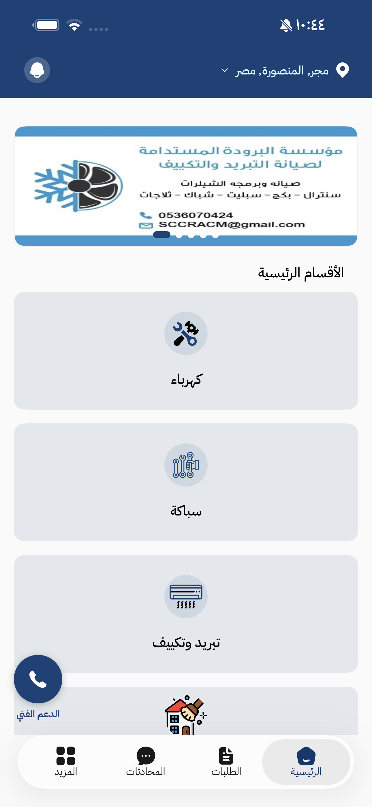
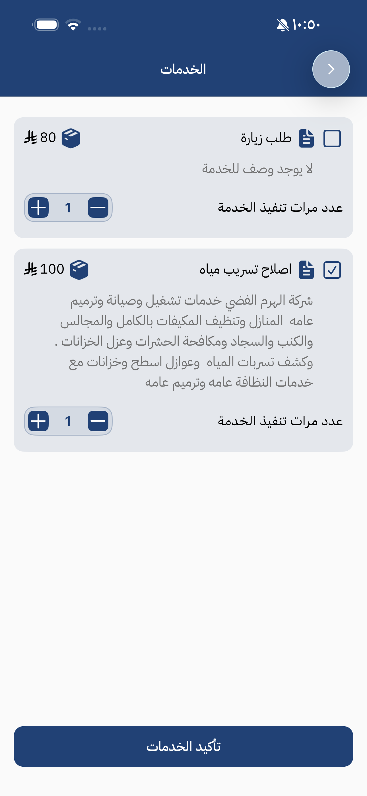
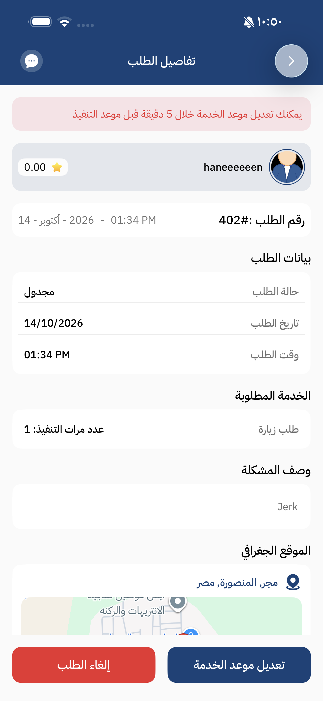
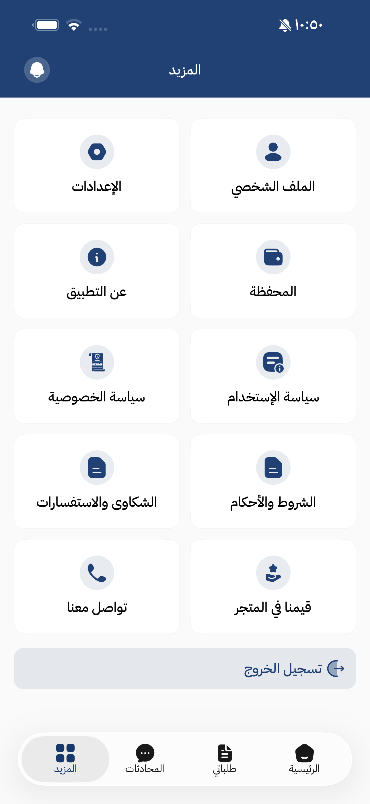

# Profix

Profix is an iOS marketplace for booking home and maintenance services. It helps customers discover service providers, choose services, schedule visits, and manage bookings. Providers can present their business profiles and services to potential customers.

## Features

- Browse service categories and providers
- Search and filter providers by service
- View provider profiles, ratings, services, and previous work
- Request services and select quantities
- Schedule, review, and manage bookings
- View order status, location, and booking details
- Chat between customers and providers, with support for text and media
- Notifications and order updates
- Wallet, profile, and account settings
- Arabic, English, and Urdu localization with right-to-left support

## Screenshots

### Home and service discovery

 

### Booking flow

| Choose services | Order details |
|:---:|:---:|
|  |  |

### Provider and account

| Provider profile | More and account options |
|:---:|:---:|
|  |  |

## Tech Stack

- Swift and UIKit, using MVVM and Combine
- Alamofire for networking
- Firebase services, including authentication, database, messaging, storage, and crash reporting
- Google Maps for location features
- Socket.IO for real-time chat
- Swift Package Manager for dependency management

## Run the App

1. Install Xcode on macOS.
2. Open `Profix.xcodeproj`.
3. Allow Xcode to resolve the Swift packages.
4. Select the `Profix` scheme and an iPhone simulator or development device.
5. Build and run the app.

Some features require project-specific Firebase setup, Google Maps configuration, backend access, and signing settings. Obtain these from the project owner. Do not commit private credentials or production secrets.

## Project Structure

- `Profix/App` — authentication, home, booking, orders, chat, notifications, and account features
- `Profix/Core` — app and scene lifecycle
- `Profix/Networking` — endpoints, requests, and response handling
- `Profix/Shared` — reusable views, helpers, and extensions
- `Profix/Resources` — assets, fonts, and animations
- `Profix/Localization` — language and right-to-left support
- `Profix/Validation` — form validation
